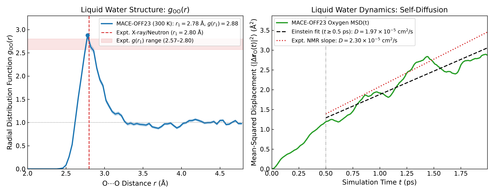

# Exercise 06

Molecular dynamics (MD) simulation of ambient liquid water  (300 K) driven by **ASE** and **MACE-OFF23**, comparing simulated liquid structure ( **$g_{\text{OO}}(r)$** ) and transport dynamics ($D$) against experimental X-ray/neutron scattering and NMR benchmarks.



## Simulation Setup

- **System:** Periodic cubic box ($L = 9.865\text{ \AA}$, $\rho = 0.997\text{ g/cm}^3$) containing $32\ \text{H}_2\text{O}$ molecules ($96\text{ atoms}$).
- **Potential:** `MACE-OFF23 (small)` in `float32` precision on CUDA GPU ($\omega\text{B97M-D3(BJ)}/\text{def2-TZVPPD}$ reference level).
- **Ensemble & Integration:** Canonical ($NVT$) Langevin thermostat at $T = 300\text{ K}$ ($\gamma = 0.01\text{ fs}^{-1}$, $\Delta t = 0.5\text{ fs}$, `FixCom()` constraint):
  - **Equilibration:** $1,000\text{ steps}$ ($0.50\text{ ps}$)
  - **Production:** $4,000\text{ steps}$ ($2.00\text{ ps}$, sampled every $5\text{ fs} \rightarrow 400\text{ frames}$)

## Results vs. Experimental Reference ($298\text{–}300\text{ K}$)

| Observable | `MACE-OFF23 (small)` ($300\text{ K}$) | Experimental Reference ($298\text{ K}$) | Physical Interpretation |
| :--- | :---: | :---: | :--- |
| **Average Temperature $T$** | $298.1 \pm 24.8\text{ K}$ | $298.15\text{ K}$ | Matches theoretical canonical fluctuation $\sigma_T = T\sqrt{2/N_{\text{dof}}} \approx 25.1\text{ K}$ |
| **1st $\text{O}\cdots\text{O}$ Peak Position $r_1$** | **$2.78\text{ \AA}$** | **$2.80\text{ \AA}$** *(X-ray / Neutron)* | Reproduces hydrogen-bonded nearest-neighbor shell within $0.02\text{ \AA}$ |
| **1st $\text{O}\cdots\text{O}$ Peak Height $g_{\text{OO}}(r_1)$** | $2.88$ | $2.57\text{–}2.80$ *(X-ray / Neutron)* | Slightly sharper peak reflects classical nuclei (missing proton zero-point tunneling) |
| **Self-Diffusion Coefficient $D$** | **$1.97 \times 10^{-5}\text{ cm}^2/\text{s}$** | **$2.30 \times 10^{-5}\text{ cm}^2/\text{s}$** *(NMR)* | Captures $\sim 86\%$ of experimental diffusivity (remaining offset from finite-size & classical-nuclei effects) |

## Usage

```bash
python md_liquid_water_mace.py   # Runs NVT MD and saves liquid_water_300K.traj
python plot_water_md.py          # Generates water_md_analysis.png, g_oo_rdf.png, msd_diffusion.png
ase gui liquid_water_300K.traj   # Interactive visualization of hydrogen-bond dynamics
```

## Challenge

Run the MD script 3 times, extract observables and compare against experimental data.

Also increase "prod_steps = 8000" , run the MD simulator once, extract observables and compare calculated results against experimental data.

